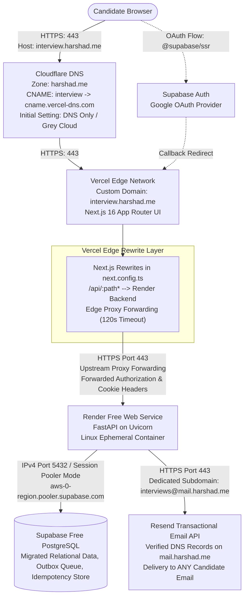
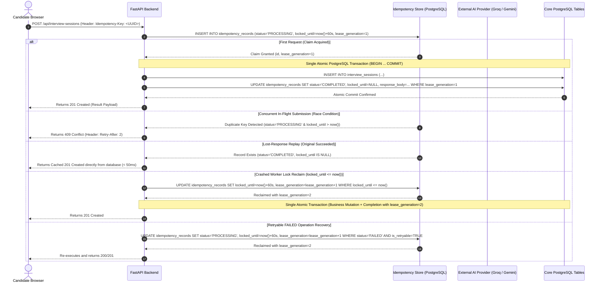
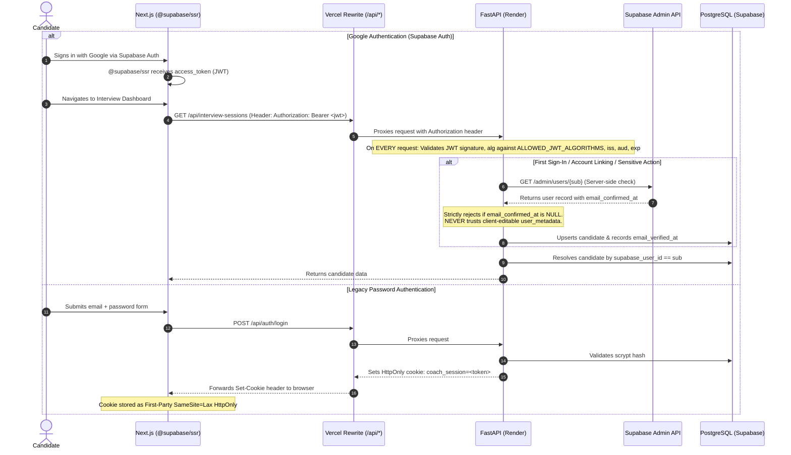

# PRODUCTION DEPLOYMENT ARCHITECTURE (TECHNICAL VALIDATION HARDENED)
## AI Interview Coach — Practice & Learning System
### Primary Target: `https://interview.harshad.me` on Vercel + Cloudflare DNS + Render Backend

**Author:** Principal Software Architect, DevOps Lead & Application Security Engineer  
**Date:** November 3, 2026 (Phase 0 Final Technical Validation Hardened)  
**Primary Target:** `https://interview.harshad.me` (Domain owned on Cloudflare)

---

## 1. System Deployment Topology



### 1.2 Supabase PostgreSQL Connection Architecture & Verification Checklist (Pre-Phase 1 Prerequisite)
Before any database migration scripts are executed or Render environment variables configured in Phase 1, the cloud infrastructure engineer must inspect the live Supabase project dashboard under **Project Settings > Database > Connection Parameters** and verify the following operational configuration:

| Configuration Item | Required Parameter Specification | Ground Truth in Architecture | Verification Method & Dashboard Path |
| :--- | :--- | :--- | :--- |
| **Project Region** | Exact cloud region code | Must match geographic proximity to Render (e.g. `us-east-1`, `eu-west-1`, or `ap-southeast-1`) | Supabase Dashboard > Project Settings > General > Region |
| **Pooler Hostname** | Session Pooler FQDN | Format: `aws-0-[region].pooler.supabase.com`. Never use direct connection hostname `db.[ref].supabase.co` on Render. | Supabase Dashboard > Project Settings > Database > Connection Pooling > Host |
| **Port & Connection Mode** | **Port 5432 in Session Mode** | SQLAlchemy uses server-side prepared statements and session-level advisory locks. **Must use Session Pooler (port 5432), NOT Transaction Pooler (port 6543)**. Transaction pooler breaks SQLAlchemy statement caching. | Supabase Dashboard > Project Settings > Database > Connection Pooling > Mode: `Session`, Port: `5432` |
| **IPv4 Compatibility** | Confirmed public IPv4 resolution | Render Free web services operate in an outbound **IPv4-only** network environment (no outbound IPv6 route). The Session Pooler hostname must resolve to IPv4 `A` records. | Command: `Resolve-DnsName -Name "aws-0-[region].pooler.supabase.com" -Type A` (must return valid IPv4 addresses) |
| **Connection Limits** | Supabase free pooler limits & pool rightsizing | Supabase Free tier provides up to 50 pooled connections. Backend SQLAlchemy must configure conservative pool parameters (`pool_size=5`, `max_overflow=2`, `pool_pre_ping=True`) to prevent pooler exhaustion. | Supabase Dashboard > Project Settings > Database > Connection Pooling > Max Client Connections |
| **SSL Requirements** | Mandatory SSL connection mode | Encrypted transport is mandatory across the public internet between Render and Supabase. FastAPI connection string must specify `?sslmode=require`. | Supabase Dashboard > Project Settings > Database > SSL Certificate > Enforce SSL enabled |

> [!IMPORTANT]
> **Zero Invention Policy:** Do NOT hardcode or invent project reference strings or database passwords in documentation. All connection parameters must be read dynamically from environment variable `DATABASE_URL` during runtime.

---

## 2. Cloudflare DNS, Vercel Limits & Safe Mutation Idempotency

### 2.1 Frontend Subdomain (`interview.harshad.me`)
1. In Cloudflare Dashboard for zone `harshad.me`, add:
   - **Type:** `CNAME`
   - **Name:** `interview`
   - **Target:** The exact CNAME target displayed in the Vercel project dashboard upon adding `interview.harshad.me` (standard: `cname.vercel-dns.com`).
   - **Proxy status:** **DNS only (Grey Cloud)** initially.
   - **TTL:** `Auto`
2. **DNS-Only (Grey Cloud) Initial Requirement:** Vercel's automated certificate issuance requires direct DNS resolution to validate domain ownership and provision Let's Encrypt / DigiCert certificates. Cloudflare proxying must remain **disabled (Grey Cloud)** during verification.
3. **Optional Cloudflare Proxying:** Once Vercel issues a valid certificate and confirms the domain, Cloudflare proxying (Orange Cloud) is **optional and requires explicit end-to-end testing**. If enabled, Cloudflare SSL/TLS encryption mode must be set to **Full (Strict)**. Proxying should not be enabled automatically without verifying that Vercel edge rewrites, headers, and streaming responses operate without interference.

### 2.2 Vercel Proxy Timeout Limits vs. Serverless Limits & Cold-Start Realities
- **Official Vercel Documentation Limits:**
  - **Serverless Function Execution Timeout:** On Vercel Hobby, serverless function execution is capped at **up to 60 seconds**.
  - **External Proxied Request Timeout:** Official Vercel documentation specifies a **120-second timeout for external proxied requests** (such as external rewrites in `next.config.ts` forwarding `/api/:path*` to Render).
- **Cold-Start Reality on Render Free Tier:**
  - Render free instances spin down into dormancy after 15 minutes of inactivity.
  - A sleeping container typically takes **50 to 90 seconds** to complete a cold boot (container allocation, Python startup, and Uvicorn initialization).
  - Because 50–90 seconds is within Vercel's 120-second proxied request timeout, an external rewrite will **not necessarily time out** during a normal cold start.
  - **Remaining Uncertainties:** However, timeouts or upstream error responses (`502 Bad Gateway` / `504 Gateway Timeout`) can still occur if:
    a) Render container allocation queues exceed 120 seconds during peak cloud demand.
    b) TCP connection resets occur during container port binding.
    c) Client-side fetch timeout or browser network drops terminate the request early.

### 2.3 Server-Side Mutation Idempotency Architecture (Phase 5 Design)
Relying solely on client GET-based reconciliation is unsafe because an asynchronous GET can race with an original POST request that is still processing inside the database or LLM gateway.

To provide definitive duplicate prevention across all state-changing operations (`POST /api/interview-sessions`, `POST /api/interview-sessions/{id}/turns`, `POST /api/interview-sessions/{id}/complete`), a server-side idempotency architecture will be implemented in Phase 5:



#### Detailed Idempotency Specification:

1. **Client-Generated Stable Operation IDs:**
   - Every mutation request generates a UUID v4 client-side before dispatch and attaches it via the `Idempotency-Key` HTTP header:
     - Session Creation: `Idempotency-Key: session-create-{client_uuid}`
     - Answer Turn Submission: `Idempotency-Key: turn-{session_id}-{seq}-{client_uuid}` (tied to session and turn sequence)
     - Session Completion: `Idempotency-Key: session-complete-{session_id}-{client_uuid}`

2. **Planned Schema (`idempotency_records`):**
   ```sql
   CREATE TABLE idempotency_records (
       id UUID PRIMARY KEY DEFAULT gen_random_uuid(),
       candidate_id UUID NOT NULL REFERENCES candidates(id) ON DELETE CASCADE,
       idempotency_key VARCHAR(128) NOT NULL,
       route_path VARCHAR(128) NOT NULL,
       status VARCHAR(20) NOT NULL DEFAULT 'PROCESSING',
       lease_generation INTEGER NOT NULL DEFAULT 1,
       request_hash VARCHAR(64) NOT NULL,
       is_retryable BOOLEAN NOT NULL DEFAULT TRUE,
       error_detail TEXT,
       response_code INTEGER,
       response_headers JSONB,
       response_body JSONB,
       created_at TIMESTAMPTZ NOT NULL DEFAULT clock_timestamp(),
       locked_until TIMESTAMPTZ DEFAULT clock_timestamp() + INTERVAL '60 seconds',
       CONSTRAINT uq_candidate_idempotency_key UNIQUE (candidate_id, idempotency_key),
       CONSTRAINT ck_idempotency_status CHECK (status IN ('PROCESSING', 'COMPLETED', 'FAILED'))
   );
   CREATE INDEX ix_idempotency_records_lookup ON idempotency_records (candidate_id, idempotency_key);
   ```

   > [!NOTE]
   > **Nullable `locked_until` Design:**
   > `locked_until` is intentionally **nullable** (`TIMESTAMPTZ DEFAULT clock_timestamp() + INTERVAL '60 seconds'`). When an operation is in `status = 'PROCESSING'`, `locked_until` contains the expiration timestamp. Once the operation transitions to `status = 'COMPLETED'` or `status = 'FAILED'`, `locked_until` is set to `NULL` because completed and failed operations no longer require or hold an active worker lease.

3. **Idempotency Failure Classification & Persistence Matrix:**
   To guarantee that client retries behave predictably and domain invariants cannot be bypassed, failures are categorized into four distinct classes:

| Failure Category | Examples | Idempotency Record Persisted? | HTTP Response to Client | Retry Behavior with Same Key |
| :--- | :--- | :---: | :---: | :--- |
| **A. Pre-Execution Validation Failures** | Unauthenticated request (401), malformed JSON syntax (422), missing mandatory headers, route/hash mismatch against existing key | **NO** (Request rejected before mutex claim is inserted) | HTTP 401 / 422 | Client corrects payload/auth and resubmits. Key was never claimed, so it remains fresh. (If key existed, stored record is left untouched). |
| **B. Transient Infrastructure Failures** | Upstream AI provider HTTP 429 (rate limit) or 503 (outage), socket connection timeouts, transient network drops | **Best-Effort YES** (`status = 'FAILED'`, `is_retryable = TRUE`, `locked_until = NULL`) when database is reachable. *(See Note below for DB unreachable/exhaustion scenarios)* | HTTP 503 / 504 / 429 (`Retry-After: N`) | **Retryable:** Client resubmits with the **same** key. Backend atomically reclaims the record (`lease_generation + 1`) and executes. |
| **C. Permanent Business-Rule Failures** | Turn submitted for completed session, turn sequence mismatch (submitting turn 5 instead of 3), role mismatch, hard domain invariant rejection | **YES** (`status = 'FAILED'`, `is_retryable = FALSE`, `locked_until = NULL`, `response_code = 4xx`) | HTTP 400 / 403 / 409 / 422 with clear invariant error payload | **Non-Retryable:** Any future request with this key is rejected with HTTP `422 Unprocessable Entity`. Client **cannot** bypass domain rules by reusing the key. |
| **D. Ambiguous External-Provider Outcomes** | Socket timeout or connection reset waiting for Groq/Gemini response | **YES** (`status = 'FAILED'`, `is_retryable = TRUE`, `locked_until = NULL`) | HTTP 504 Gateway Timeout (`Retry-After: 3`) | **Retryable:** Client retries with the **same** key. Backend re-calls provider; fencing tokens ensure stale LLM responses cannot commit. |

   > [!IMPORTANT]
   > **Best-Effort Persistence & Database Unavailability Reality:**
   > Transitioning to `status = 'FAILED'` is strictly a **best-effort operation**:
   > 1. When the failure occurs in an external component (e.g. AI provider returns 429/503 or socket times out), FastAPI has an active database connection and successfully persists `status = 'FAILED'`, `is_retryable = TRUE`, `locked_until = NULL`.
   > 2. **However, if the failure itself is database pool exhaustion, PostgreSQL unavailability, or a network partition to PostgreSQL**, the backend **cannot write to `idempotency_records`**.
   > 3. In this database failure scenario, the backend **does NOT promise a persisted failure state**. Instead, the existing record remains in `status = 'PROCESSING'` with its un-updated `locked_until` timestamp.
   > 4. Once `clock_timestamp() >= locked_until`, the lease naturally expires, permitting a subsequent client retry to reclaim the lock via conditional update once database connectivity is restored.

   > [!CRITICAL]
   > **Committed Operations Protection:**
   > If a record is in `status = 'COMPLETED'`, it represents a successfully committed database mutation. Any incoming request with the same `(candidate_id, idempotency_key)` and matching route/hash immediately receives the cached HTTP response in $< 50\text{ms}$. A completed operation can **never** be overwritten, reverted to `PROCESSING`, or re-executed under any circumstances.

4. **Strict Lease Ownership Semantics & Wall-Clock Validity:**
   - **Decision: Strict Lease Ownership.** In this architecture, an expired worker **CANNOT commit under any circumstances**, even if no other worker has arrived to reclaim the lease yet.
   - *Rationale:* Allowing an expired worker to commit if nobody has reclaimed the lease creates a race condition: Worker 2 could read `locked_until <= clock_timestamp()`, begin reclaiming, while Worker 1 commits concurrently, leading to split-brain or overlapping execution.
   - **Triple-Condition Lease Invariant:** A worker owns a valid lease ONLY while ALL three conditions hold simultaneously:
     1. `status = 'PROCESSING'`
     2. `lease_generation = :claimed_lease_generation`
     3. `locked_until > clock_timestamp()`
   - **Atomic Single-Transaction Completion Pattern:**
     For single-transaction operations (e.g. `POST /api/interview-sessions`, `POST /api/interview-sessions/{id}/complete`), the business mutation and the idempotency completion are committed in the **exact same PostgreSQL transaction**, enforcing strict lease validity:
     ```python
     with db.begin():
         # 1. Execute business mutation (e.g., insert interview_session row)
         db.add(new_session)
         db.flush()
         
         # 2. In the EXACT same transaction, update idempotency record to COMPLETED
         # Enforces: claimed lease_generation AND valid unexpired wall-clock lease
         result = db.execute(
             text("""
                 UPDATE idempotency_records
                 SET status = 'COMPLETED',
                     response_code = 201,
                     response_headers = :headers,
                     response_body = :body,
                     locked_until = NULL
                 WHERE candidate_id = :cid
                   AND idempotency_key = :key
                   AND lease_generation = :claimed_lease
                   AND status = 'PROCESSING'
                   AND locked_until > clock_timestamp();
             """),
             {
                 "headers": json.dumps(headers),
                 "body": json.dumps(body),
                 "cid": candidate_id,
                 "key": key,
                 "claimed_lease": claimed_lease,
             }
         )
         if result.rowcount == 0:
             # Either lease expired or was reclaimed by another worker
             raise FencingTokenViolationError("Worker lease expired or was reclaimed. Business transaction aborted.")
     ```
     If the worker's wall-clock lease has expired (`locked_until <= clock_timestamp()`), `result.rowcount` is 0. The Python transaction context manager intercepts the exception and issues a PostgreSQL `ROLLBACK`, guaranteeing that an expired worker cannot commit business mutations.

5. **Failure Handlers & Strict Fencing:**
   When an active worker catches a failure, it updates the record enforcing the exact same lease ownership:
   ```sql
   UPDATE idempotency_records
   SET status = 'FAILED',
       is_retryable = :is_retryable,
       error_detail = :error_detail,
       response_code = :error_code,
       response_body = :error_body,
       locked_until = NULL
   WHERE candidate_id = :candidate_id
     AND idempotency_key = :idempotency_key
     AND lease_generation = :claimed_lease_generation
     AND status = 'PROCESSING'
     AND locked_until > clock_timestamp();
   ```
   If the worker's lease expired before it caught the error, `rowcount == 0` and the update is safely ignored, leaving the record for a subsequent retry to reclaim.

6. **Concurrent Requests (In-Flight Mutex):**
   - If the key already exists and `status = 'PROCESSING'` with `locked_until > clock_timestamp()`, FastAPI immediately returns `409 Conflict` with `Retry-After: 2`. The client waits rather than launching parallel evaluations.

7. **Lost-Response Recovery (Completed Request):**
   - If `status = 'COMPLETED'`, FastAPI validates:
     - `candidate_id` matches current authenticated candidate.
     - `route_path` matches incoming request endpoint (rejecting with `422 Unprocessable Entity` on route mismatch).
     - `request_hash` matches incoming payload hash (rejecting with `422 Unprocessable Entity` on payload mismatch).
   - Once validated, FastAPI immediately returns the cached `response_code` and `response_body` directly from the database in $< 50\text{ms}$ without re-executing any business logic or touching external APIs.

8. **Atomic Recovery of Retryable FAILED Operations:**
   When a retry request arrives with an existing `(candidate_id, idempotency_key)`:
   1. Validate `route_path` and `request_hash`. If either mismatches, return `422 Unprocessable Entity`.
   2. If `status = 'FAILED'` and `is_retryable = FALSE`: **Permanently failed operations CANNOT be retried with the same idempotency key.** FastAPI rejects the request with `422 Unprocessable Entity` ("Operation previously failed permanently; generate a new Idempotency-Key").
   3. If `status = 'FAILED'` and `is_retryable = TRUE`: Reclaim the record via atomic conditional update:
      ```sql
      UPDATE idempotency_records
      SET status = 'PROCESSING',
          locked_until = clock_timestamp() + INTERVAL '60 seconds',
          lease_generation = lease_generation + 1,
          is_retryable = TRUE,
          error_detail = NULL
      WHERE candidate_id = :candidate_id
        AND idempotency_key = :idempotency_key
        AND route_path = :route_path
        AND request_hash = :request_hash
        AND (
            (status = 'PROCESSING' AND locked_until IS NOT NULL AND locked_until <= clock_timestamp())
            OR
            (status = 'FAILED' AND is_retryable = TRUE)
        )
      RETURNING id, lease_generation;
      ```
   - **Concurrent Retries on FAILED Records:** Because the update is atomic in PostgreSQL, exactly one worker wins the conditional update and receives the returned row with incremented `lease_generation`. Any concurrent worker matches `0 rows`, re-checks the record, finds `status = 'PROCESSING'` with an active lease, and returns `409 Conflict` (`Retry-After: 2`).

9. **External LLM Execution: Heartbeats, Cancellation Limits & Quotas:**
   - **Lease Expiration During LLM Calls:** Default lease duration is 60 seconds. A background keepalive coroutine runs every 20 seconds, executing:
     ```sql
     UPDATE idempotency_records
     SET locked_until = clock_timestamp() + INTERVAL '60 seconds'
     WHERE id = :id
       AND lease_generation = :claimed_lease_generation
       AND status = 'PROCESSING'
       AND locked_until > clock_timestamp();
     ```
   - **Heartbeat Failure Behavior:** If the database becomes unreachable, or event loop stalls, or network partition occurs, the heartbeat update fails (`rowcount == 0` or connection error). Once `locked_until` passes, the worker's lease is **dead**. The worker coroutine cancels its local inference processing task.
   - **Cancellation Limitations:** In Python `asyncio`, cancelling an `httpx` task closes the client-side TCP socket. **However, external LLM providers (Groq, Gemini, NVIDIA NIM) do NOT cancel inference on their servers.** The provider has already received the HTTP POST payload and will compute the inference to completion on its GPU/TPU cluster. Calling `task.cancel()` does NOT refund consumed provider rate quotas or tokens.
   - **Late Response & Stale-Result Rejection:** If a delayed LLM response arrives at Worker 1 after its lease expired (or was reclaimed by Worker 2 with `lease_generation = 2`), Worker 1 attempts to commit with `WHERE lease_generation = 1 AND locked_until > clock_timestamp()`. PostgreSQL matches **0 rows**. Worker 1's transaction aborts, and the stale LLM response is safely discarded. Stale results are never written to `interview_questions` or `answer_evaluations`.
   - **Bounded Retries & Quota Consumption Reality:**
     - Client/worker retries for a turn are strictly bounded to **maximum 2 retries** (3 total attempts).
     - **Explicit Quota Warning:** Fencing protects database state from duplicate writes; **fencing DOES NOT prevent duplicate external inference calls**. An ambiguous timeout followed by a retry will dispatch a second independent inference call to Groq/Gemini, consuming additional rate-limit quota (Groq: 30 RPM / 14,400 RPD; Gemini: 15 RPM / 1,500 RPD).
   - **Demarcation of Guarantees:**
     - **PostgreSQL Database Mutations:** The system provides **at-most-once committed database mutations per candidate and idempotency key, with cached response replay for completed operations**. Exactly zero duplicate interview sessions, question turns, or evaluations are committed to the database.
     - **External LLM Calls:** **At-least-once execution.** Due to the absence of provider-side idempotency, duplicate external inference calls can occur during network timeouts or worker crashes.

10. **Key Validation, Namespace Isolation & 7-Day Retention:**
    - **Candidate Identity Validation:** The uniqueness constraint is scoped to `(candidate_id, idempotency_key)`. Candidate namespaces are isolated. If Candidate A uses `"key-1"`, Candidate B using `"key-1"` operates in Candidate B's isolated space without cross-tenant collision or data leakage.
    - **Route Path & Payload Validation:** If a key is resubmitted to a different route path or with a modified payload hash, FastAPI immediately rejects it with `422 Unprocessable Entity` ("Idempotency key route mismatch" or "Idempotency key payload mismatch").
    - **Idempotency Key Retention & Cleanup:**
      - Completed and failed idempotency records are retained for **7 days** to support interview lifecycle reviews, report caching, and delayed client retries.
      - A daily maintenance sweep purges records older than 7 days:
        ```sql
        DELETE FROM idempotency_records
        WHERE created_at < clock_timestamp() - INTERVAL '7 days'
          AND status IN ('COMPLETED', 'FAILED');
        ```
      - **Expired Records & Key Reuse:** Once an idempotency record is deleted after 7 days, that key behaves as a new, unseen key. Because client keys are generated as UUID v4 (128-bit random entropy, collision probability $O(10^{-18})$), natural key collisions across sessions are practically impossible.

10. **Crash Window Durability Matrix:**
    - **Crash before business transaction:** Business table rows: `0`. Idempotency status: `PROCESSING`, `lease_generation = 1`, `locked_until = T + 60s`. Immediate retry receives `409 Conflict`. Retry after `locked_until <= clock_timestamp()` reclaims lock with `lease_generation = 2` and executes cleanly. Exactly 1 business row created.
    - **Crash during business transaction:** PostgreSQL engine automatically rolls back uncommitted changes. Business table rows: `0`. Idempotency record status remains `PROCESSING`. Retry after lock expiry reclaims with `lease_generation = 2`. Zero partial or duplicate rows.
    - **Crash after business transaction commits but before HTTP response delivered:** Business mutation and idempotency record (`status = 'COMPLETED'`, cached payload, `locked_until = NULL`) committed durably together. Business table rows: `1`. Client retry reads cached response in $< 50\text{ms}$. Zero re-execution; business mutation count remains strictly 1.

11. **Comprehensive 10-Scenario Idempotency Regression Test Suite (Phase 5 Quality Gate):**
    Phase 5 includes 10 explicit automated regression tests in `backend/tests/test_idempotency.py` verifying database mutations and external call counts:
    - `test_idempotency_completion_nullable_locked_until`: Verifies atomic transaction commit sets `status = 'COMPLETED'` and `locked_until = NULL` without constraint violation; subsequent DB query confirms `locked_until IS NULL`.
    - `test_idempotency_retryable_failed_recovery`: Simulates transient provider failure setting `status = 'FAILED'`, `is_retryable = TRUE`, `locked_until = NULL`; subsequent retry reclaims record, sets `status = 'PROCESSING'`, increments `lease_generation` by 1, and creates exactly 1 business mutation upon completion.
    - `test_idempotency_permanent_failed_rejection`: Simulates permanent validation/invariant failure setting `status = 'FAILED'`, `is_retryable = FALSE`; retry with same key is rejected with `422 Unprocessable Entity`; database mutation count remains strictly 0.
    - `test_idempotency_concurrent_recovery_of_failed`: Dispatches 2 concurrent requests to retry a retryable FAILED record; exactly 1 worker acquires lease (`lease_generation + 1`); second worker receives `409 Conflict` (`Retry-After: 2`); database mutation count is strictly 1.
    - `test_idempotency_ambiguous_provider_timeout_duplicate_call`: Simulates LLM provider socket timeout on first attempt followed by retry; verifies external mock LLM client was called exactly 2 times (at-least-once external call), but database commits exactly 1 turn evaluation (at-most-once DB mutation).
    - `test_idempotency_stale_llm_result_rejection`: Worker 1 experiences latency; Worker 2 reclaims lease (`lease_generation = 2`) and commits turn; Worker 1's delayed LLM response attempts commit with `lease_generation = 1`; verifies update matches 0 rows, Worker 1 aborts, and database retains only Worker 2's evaluation.
    - `test_idempotency_stale_heartbeat_rejection`: Simulates worker whose lease expired and was reclaimed; worker sends heartbeat with stale `lease_generation`; heartbeat query updates 0 rows; worker detects lease loss and gracefully aborts.
    - `test_idempotency_route_mismatch_rejection`: Submits an existing key to a different route endpoint; verifies HTTP `422 Unprocessable Entity` ("Idempotency key route mismatch") and 0 mutations executed.
    - `test_idempotency_candidate_mismatch_isolation`: Candidate A creates an idempotency record; Candidate B submits same key; verifies Candidate B's request operates in Candidate B's isolated namespace without collision or access to Candidate A's cached response.
    - `test_idempotency_retention_and_expiration`: Simulates records aged $> 7$ days; runs cleanup sweep; verifies completed/failed records $> 7$ days are deleted, while active/recent records are preserved; verifies deleted key subsequently behaves cleanly as a new record.

12. **Implementation Boundary:** This server-side mechanism is specified for Phase 5 implementation and verification; it will not be created or deployed during Phase 0.

### 2.4 Resend DNS Instructions & DMARC Safety
1. **Dynamic Resend Configuration:**
   - In the Resend Dashboard, register the sending domain as **`mail.harshad.me`**.
   - Do **NOT** assume fixed DNS hostnames or a hardcoded record set. Resend dynamically generates the specific DNS records required for that account and region.
2. **Exact DNS Records to Add in Cloudflare (Zone: `harshad.me`):**
   - Enter the exact records displayed in the Resend Dashboard into Cloudflare DNS for the zone `harshad.me`:

| Record Type | Name / Host | Target / Value | Priority | Proxy Status | Purpose |
| :--- | :--- | :--- | :---: | :---: | :--- |
| **MX** | `mail` (or `mail.harshad.me`) | `feedback-smtp.us-east-1.amazonses.com` (or exact value from Resend) | `10` | **DNS Only** (Grey Cloud) | Inbound bounce & complaint routing to Resend |
| **TXT** (SPF) | `mail` (or `mail.harshad.me`) | `"v=spf1 include:amazonses.com ~all"` (or exact value from Resend) | - | **DNS Only** (Grey Cloud) | Sender Policy Framework authorizing Resend infrastructure |
| **CNAME** or **TXT** (DKIM) | `resend._domainkey.mail` (or selector from Resend) | Exact dynamic public key token generated in Resend Dashboard | - | **DNS Only** (Grey Cloud) | Cryptographic signature validation for email authenticity |

   - Enter Priority and TTL exactly as specified by Resend (TTL: `Auto` if unspecified). Proxy status MUST be **DNS Only** (Cloudflare HTTP proxying cannot proxy SMTP/mail records).
3. **DMARC Safety & Policy Decisions:**
   - **DMARC is a separate policy decision and is NOT automatically provided by Resend.**
   - **Do NOT unconditionally create `v=DMARC1; p=none;`.** DMARC is an organizational email security policy, not a generic setting to copy-paste.
   - **Mandatory Existing Record Inspection:** Before creating or altering any DMARC record, the operator MUST inspect existing DNS records in Cloudflare for zone `harshad.me` (specifically querying `TXT _dmarc.harshad.me`).
   - **Prevent Duplicate or Conflicting Records:** Duplicate `_dmarc` records or conflicting policies must **never** be created. If an existing apex DMARC record specifies a subdomain policy (e.g. `sp=reject` or `sp=quarantine`), adding a loose `p=none` at `_dmarc.mail.harshad.me` can inadvertently weaken domain protections and violate organizational security policy.
   - If no DMARC record exists for the zone and organizational policy warrants monitoring, a non-conflicting TXT record at `_dmarc.mail.harshad.me` with `v=DMARC1; p=none;` may be created under operator supervision.
4. **Apex Domain Protection:**
   - Apex domain `harshad.me` MX, SPF, root web server, and existing apex DMARC records remain completely untouched. All email traffic is isolated strictly to the `mail.harshad.me` subdomain.
5. **Mandatory Prerequisite:**
   - Domain verification status showing **"Verified"** in the Resend Dashboard is a mandatory prerequisite before transactional email dispatch is enabled in production.

---

## 3. Reconciled Authentication & Security Architecture



### 3.1 Bearer Token for Supabase, Cookie for Legacy
1. **Decoupled Architecture:** Supabase access tokens are standard OAuth Bearer JWTs. The client retrieves the current token via `supabase.auth.getSession()` and passes it in the `Authorization: Bearer <access_token>` header.
2. **Next.js Rewrite Transparency:** Next.js same-origin rewrites (`/api/:path*` $\to$ Render) forward the `Authorization` header without requiring server-side cookie decrypting or re-wrapping in Next.js middleware.
3. **Cookie Security Honesty:** Supabase client session tokens managed by `@supabase/ssr` in the browser are client-accessible; we do not make false claims that Supabase tokens are HttpOnly. Conversely, the legacy `coach_session` cookie set by FastAPI is **strictly HttpOnly, Secure, and SameSite=Lax**.
4. **FastAPI Dual Authentication Dependency:** FastAPI's `current_candidate` dependency accepts:
   - `Authorization: Bearer <supabase_jwt>` $\to$ Validates Supabase JWT, maps `sub` to `Candidate.supabase_user_id`.
   - `Cookie: coach_session=<token>` $\to$ Validates token hash against `auth_sessions` table.
   - Both return the standard `Candidate` model instance.

### 3.2 Supabase Signing Configuration & Prerequisite Timing
1. **Timing of Prerequisite Resolution:**
   - Determining the active signing algorithm (`RS256` / `ES256` vs `HS256`) is an **unresolved implementation prerequisite for Phase 2 (Authentication)**.
   - It does **NOT** block Phase 1 deployment preparation (DNS, Vercel rewrites, Uvicorn settings, and Session Pooler configuration), which operate independently of JWT verification.
2. **Verification Method:**
   - When project access is available, query `https://<ref>.supabase.co/auth/v1/.well-known/jwks.json` and inspect the Supabase Dashboard under **Project Settings > API > JWT Settings**.
   - **Never infer HS256 merely because JWKS is empty or inaccessible.**
3. **Strict Algorithm Allowlist:**
   - FastAPI enforces `ALLOWED_JWT_ALGORITHMS` (e.g. `["RS256"]` or `["HS256"]`).
   - Never accept an algorithm solely because the unverified JWT header requests it.

### 3.3 Email Confirmation Policy & Verification Timing
1. **Every Authenticated Request:**
   - Cryptographic signature validation, expiration (`exp`), audience (`aud == "authenticated"`), issuer (`iss`), and algorithm allowlist validation occur on **every single request**.
2. **Strictly Untrusted Metadata:**
   - `user_metadata.email_verified` is client-editable by any user via `supabase.auth.updateUser()`. It is **strictly ignored and untrusted**.
3. **Server-Side Trusted Verification Timing:**
   - Trusted verification via the Supabase Auth Admin API (`admin.get_user_by_id(sub)`) inspecting `auth.users.email_confirmed_at` occurs:
     - **Initial Provisioning:** Upon first sign-in via Google OAuth, `email_confirmed_at` is checked. If verified, the candidate record is created with `email_verified_at = email_confirmed_at`.
     - **Account Linking:** When a candidate links a Google OAuth account to an existing email/password account, `email_confirmed_at` is re-verified to prevent identity hijacking.
     - **Sensitive Operations:** For high-privilege actions (e.g. launching an interview session), unverified candidate records are blocked or re-verified with Supabase.

---

## 4. Email Outbox Concurrency, Schema & At-Least-Once Delivery

### 4.1 Reconciled Outbox Schema (Phase 3 Alembic Migration)
To guarantee consistency across worker SQL, sweeps, retry tracking, lease expiration, and dispatch fencing, `scheduled_at` is used consistently as the planned execution timestamp, `locked_until` tracks worker lease ownership, `last_attempt_at` is recorded upon claim, `dispatch_generation` acts as an atomic fencing token, and `resend_idempotency_key` is persisted:

```sql
CREATE TABLE interview_email_outbox (
    id UUID PRIMARY KEY DEFAULT gen_random_uuid(),
    session_id UUID NOT NULL REFERENCES interview_sessions(id) ON DELETE CASCADE,
    candidate_id UUID NOT NULL REFERENCES candidates(id) ON DELETE CASCADE,
    notification_type VARCHAR(50) NOT NULL,
    recipient_email VARCHAR(255) NOT NULL,
    status VARCHAR(20) NOT NULL DEFAULT 'PENDING',
    dispatch_generation INTEGER NOT NULL DEFAULT 1,
    resend_idempotency_key VARCHAR(128) NOT NULL,
    attempt_count INTEGER NOT NULL DEFAULT 0,
    scheduled_at TIMESTAMP WITH TIME ZONE NOT NULL DEFAULT clock_timestamp(),
    locked_until TIMESTAMP WITH TIME ZONE,
    last_attempt_at TIMESTAMP WITH TIME ZONE,
    sent_at TIMESTAMP WITH TIME ZONE,
    error_detail TEXT,
    last_error_category VARCHAR(50),
    created_at TIMESTAMP WITH TIME ZONE NOT NULL DEFAULT clock_timestamp(),
    updated_at TIMESTAMP WITH TIME ZONE NOT NULL DEFAULT clock_timestamp(),
    CONSTRAINT uq_email_outbox_session_notification UNIQUE (session_id, notification_type),
    CONSTRAINT ck_email_outbox_status CHECK (status IN ('PENDING', 'PROCESSING', 'SENT', 'RETRY', 'FAILED'))
);

CREATE INDEX ix_interview_email_outbox_claim 
ON interview_email_outbox (status, scheduled_at, attempt_count);
```

### 4.2 Safe Concurrent Worker Claiming & Fenced Stale Recovery
The worker claim query consistently filters on `scheduled_at <= NOW()`, enforces the 3-attempt ceiling (`attempt_count < 3`), sets the 15-minute lease (`locked_until`), and updates `last_attempt_at`:

```sql
WITH claimed AS (
    SELECT id
    FROM interview_email_outbox
    WHERE status IN ('PENDING', 'RETRY')
      AND scheduled_at <= NOW()
      AND attempt_count < 3
    ORDER BY scheduled_at ASC
    FOR UPDATE SKIP LOCKED
    LIMIT 10
)
UPDATE interview_email_outbox
SET status = 'PROCESSING',
    attempt_count = attempt_count + 1,
    locked_until = NOW() + INTERVAL '15 minutes',
    last_attempt_at = NOW(),
    updated_at = NOW()
FROM claimed
WHERE interview_email_outbox.id = claimed.id
RETURNING interview_email_outbox.*;
```

- **Transaction Boundaries:**
  - Claim runs in a short-lived transaction, commits `status = 'PROCESSING'`, `locked_until = NOW() + INTERVAL '15 minutes'`, and `last_attempt_at = NOW()`, releasing row locks.
  - Dispatch to Resend occurs over HTTPS **outside any database transaction**.
- **Stale `PROCESSING` Recovery & Strict 3-Attempt Limit Enforcement:**
  - *Race Condition & Limit Violation Prevented:* If Worker 1 claims an outbox row at $T=0$, experiences an extreme HTTP socket delay or CPU stall, and at $T=15\text{m}$ Worker 2 sweeps stuck `PROCESSING` records whose lease has expired (`locked_until <= NOW()`), the recovery logic must strictly respect the maximum attempt ceiling and prevent unbounded execution.
  - *Atomic Two-Stage Recovery & Terminal Failure Transition:*
    1. **Terminal Transition for Stale Jobs with Exhausted Attempts ($\ge 3$):**
       If a stuck record is already at or above attempt 3, it **cannot be reclaimed**. It is transitioned immediately to terminal `FAILED`:
       ```sql
       UPDATE interview_email_outbox
       SET status = 'FAILED',
           last_error_category = 'MAX_RETRIES_EXCEEDED',
           error_detail = 'Worker processing lease expired after reaching maximum attempt ceiling (3). Terminated without reclaim.',
           locked_until = NULL,
           updated_at = NOW()
       WHERE status = 'PROCESSING'
         AND locked_until <= NOW()
         AND attempt_count >= 3;
       ```
    2. **Atomic Reclaim with Fencing for Stale Jobs with Budget Remaining ($< 3$):**
       Only rows with `attempt_count < 3` may be reclaimed. The query atomically increments `attempt_count` and `dispatch_generation` and extends `locked_until`:
       ```sql
       UPDATE interview_email_outbox
       SET status = 'PROCESSING',
           dispatch_generation = dispatch_generation + 1,
           attempt_count = attempt_count + 1,
           locked_until = NOW() + INTERVAL '15 minutes',
           last_attempt_at = NOW(),
           updated_at = NOW()
       WHERE id = :id
         AND status = 'PROCESSING'
         AND locked_until <= NOW()
         AND attempt_count < 3
       RETURNING *;
       ```
    3. **Fenced Completion Check with Lease Expiry Validation:**
       When an email worker finishes dispatching to Resend, it updates the outbox record enforcing **both** generation fencing and active unexpired lease ownership:
       ```sql
       UPDATE interview_email_outbox
       SET status = 'SENT',
           sent_at = NOW(),
           locked_until = NULL,
           updated_at = NOW()
       WHERE id = :id
         AND status = 'PROCESSING'
         AND dispatch_generation = :claimed_dispatch_generation
         AND locked_until > NOW();
       ```
       If the worker's 15-minute lease expired (`locked_until <= NOW()`) or another worker reclaimed the row (`dispatch_generation` changed), this update matches **0 rows**. The stale worker detects the lease rejection and drops the operation without marking the row as sent.
    4. **Persisted Resend Idempotency Key:** When inserting the outbox row, FastAPI generates a stable, deterministic key: `email-{session_id}-{notification_type}` and stores it in `resend_idempotency_key`. **Both the original worker and any recovery worker pass this exact persisted key** in the `Idempotency-Key` HTTP header to Resend.

### 4.3 At-Least-Once Delivery & Provider Deduplication Retention Window
- Delivery is strictly **at-least-once with durable database deduplication**, NOT guaranteed exactly-once.
- **Deduplication Layers:**
  1. Unique outbox row creation: `(session_id, notification_type)` constraint prevents duplicate queueing.
  2. Application-level SENT guard: once marked `SENT`, row is never queried for dispatch.
  3. Resend 24-hour key retention: Persisted `resend_idempotency_key` prevents duplicate sends within 24 hours.
- **Provider Retention Window & Duplicate Email Reality:**
  - Resend's API deduplication is bounded strictly by Resend's **24-hour `Idempotency-Key` retention window**.
  - If a worker claims an email, dispatches to Resend (which successfully sends the email), but the container crashes or sleeps before committing `status = 'SENT'`;
  - AND if a subsequent retry or recovery dispatch occurs **more than 24 hours later** (e.g. following prolonged container dormancy over a weekend), Resend's 24-hour idempotency cache will have expired.
  - Resend will treat the identical key as a new request and dispatch a duplicate email.
  - Therefore, email deduplication is **strictly guaranteed within Resend's 24-hour retention window**. Beyond 24 hours, the delivery guarantee is strictly **at-least-once**, and a duplicate email may be delivered.
- **Retry Schedule (Consistent `scheduled_at` Usage):**
  - Attempt 1: Immediate dispatch upon report completion (`scheduled_at = NOW()`, `attempt_count = 1`).
  - Attempt 2 (First Retry): `scheduled_at = NOW() + INTERVAL '2 minutes'` (`attempt_count = 2`).
  - Attempt 3 (Second & Final Retry): `scheduled_at = NOW() + INTERVAL '10 minutes'` (`attempt_count = 3`).
  - Terminal Transition: If Attempt 3 fails, status transitions to `FAILED` with `last_error_category = 'MAX_RETRIES_EXCEEDED'`.
- **Render Container Dormancy:** If Render sleeps past `scheduled_at`, pending jobs are swept immediately upon container wake-up (querying `scheduled_at <= NOW()`).

---

## 5. Capacity & Recovery Target Metrics

- **Concurrent Candidates Capacity:** 20 concurrent active candidates (*Unverified target metric until load-tested in Phase 5*).
- **Target RPO (Recovery Point Objective):** $\le 7$ days (or interval between manual dumps) (*Target metric until tested by rehearsal*).
- **Target RTO (Recovery Time Objective):** 15–30 minutes (*Target metric until tested by rehearsal*).
- **Dormancy Policies:** Render free instances sleep after 15m (50–90s cold start). Supabase Free pauses after 7 days of inactivity. Resend Free is limited to 100 emails/day. Free-tier infrastructure does not provide commercial production-grade SLAs.
